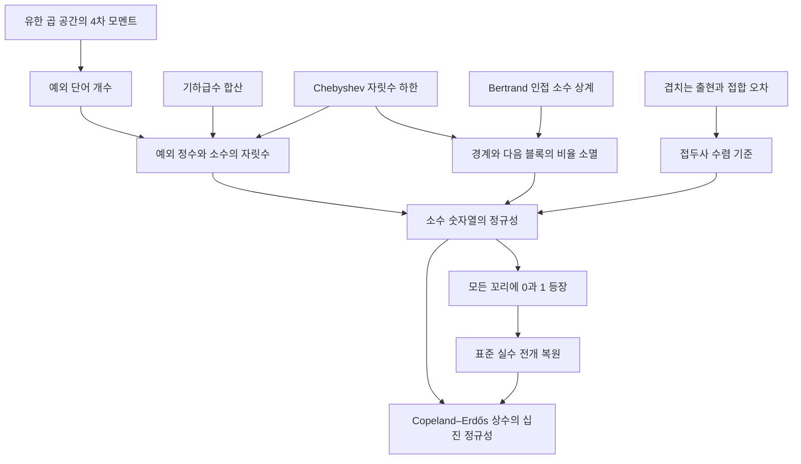

# 증명 지도와 공개 API

최종 조립의 전체 컴파일·공리 감사 결과는 검증 기록에서 확인한다.
아래 대응은 종이 증명의 문장과 실제 Lean 선언을 연결한다.

아래 선언의 공통 접두사는 `CopelandErdos.`다.

| 종이 증명 | Lean 선언 | 파일 |
|---|---|---|
| 겹치는 출현 C와 접합 경계 | `Words.occurrenceCount`, `Words.abs_occurrenceCount_flatten_sub_le` | `Words/Occurrences`, `Words/Concatenation` |
| 실제 유한 곱 공간의 4차 모멘트 | `Probability.mean_coordinateSum_fourth_le` | `Probability/FiniteMoments` |
| 예외 단어 (W) | `Words.exists_badWords_card_le` | `Words/BadWords` |
| 길이별 합산 | `Analysis.exists_pos_sum_geometric_div_sq_le` | `Analysis/GeometricBounds` |
| 예외 정수 (B)의 정수 로그 형태 | `NumberTheory.exists_badIntegersBelow_card_le_log_length_linear` | `NumberTheory/BadIntegerCounting` |
| 전체 소수 자릿수 (L) | `NumberTheory.eventually_primeDigitMass_ge` | `NumberTheory/PrimeDigitMass` |
| 예외 소수 자릿수 비율 | `NumberTheory.tendsto_badPrimeMass_div_primeDigitMass` | `NumberTheory/BadPrimeMass` |
| 경계 및 다음 블록 비율 | `NumberTheory.tendsto_index_div_cumulativeLength`, `NumberTheory.tendsto_primeBlock_length_div_cumulativeLength` | `NumberTheory/PrimePrefixBounds` |
| 모든 접두사로의 이전 | `Normality.tendsto_prefixFrequency_of_boundary` | `Normality/PrefixTransfer` |
| 실제 소수 숫자열의 정규성 | `Normality.normalDigits_primeDigits` | `Normality/PrimeConcatenation` |
| 정규성에서 모든 꼬리의 숫자 재등장 | `Normality.normalDigits_recurs` | `Normality/NormalDigits` |
| 실수 값에서 원래 자리 복원 | `Digits.digits_ofDigits_of_canonical` | `Digits/RealExpansion` |
| 최종 십진 실수 정규성 | `Normality.copelandErdos_normal` | `Normality/RealBridge` |
| 양화사를 펼친 최종 빈도 수렴 | `Normality.tendsto_copelandErdos_patternFrequency` | `Normality/RealBridge` |

## 최종 진술에서 읽어야 할 내용

- `copelandErdos`는 실제 소수 전개를 이어 붙인 `primeDigits 10`의 `Real.ofDigits`다.
- `NormalDigits`는 모든 k>0과 모든 길이-k 숫자 패턴을 양화한다.
- 계수는 접합점을 가로지르는 출현을 포함해 겹치는 모든 출현을 센다.
- 분모는 전체 접두사 길이 M이며, 극한은 모든 자연수 M을 따라 취한다.
- `NormalInBase 10 x`는 x∈[0,1)와 `Real.digits x 10`의 정상 빈도를 함께 요구한다.
- `copelandErdos_pos`, `copelandErdos_lt_one`, `digits_copelandErdos`도 별도로 제공한다.

공개 사용 예제는 [`examples/Normality.lean`](../examples/Normality.lean)이다.
중간의 generic criterion은 수렴 가정을 받지만 최종 `copelandErdos_normal`에는
미증명 수학 가정이 없다. 같은 실수의 모든 진법 정규성이나
Smarandache–Wellin 소수의 무한성을 주장하지 않는다.
